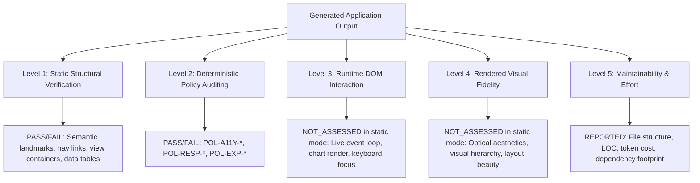
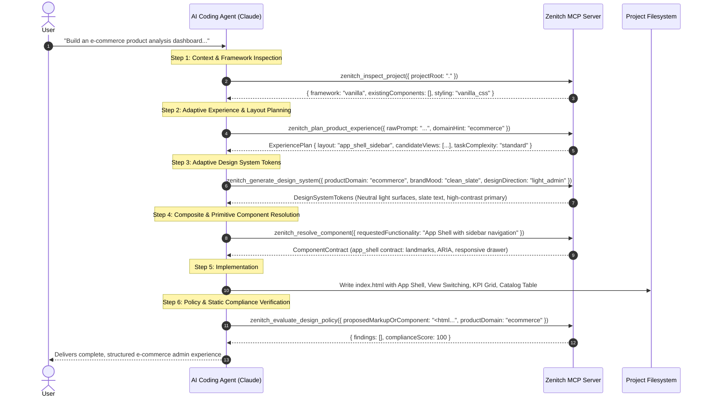
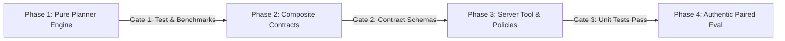

# Zenitch MCP — Product Experience Intelligence (PXI)
## Architecture Design Proposal & Capability Specification (Revision 2 — Post-Review)

**Document Version:** `2.0.0-revised`  
**Status:** `DESIGN-ONLY GATE — PENDING ARCHITECTURE REVIEW`  
**Auditor / Role:** Senior MCP Architect, AI Coding-Agent Systems Engineer, Product Designer, Evaluation Engineer  
**Architecture Reviewer:** ChatGPT  
**Implementation Agent:** Antigravity  
**Target Repository:** `genalpha uiux` / `zenitch-mcp`  

---

## Executive Summary

When AI coding agents (such as Claude 3.5 Sonnet, GPT-4o, or Gemini 1.5 Pro) receive concise product requests like *"Build a dashboard to visualize and analyze products sold in an e-commerce website with reports for particular products and all products"*, they reliably produce functional code. However, they consistently suffer from an **architectural experience deficit**:
1. **Context-Insensitive Aesthetic Defaulting:** Agents frequently default to dark mode with saturated neon cards even when a daylight administrative workflow benefits from clean, high-contrast surfaces for accurate product imagery. Conversely, if a user requests a dark gaming or terminal dashboard, agents may incorrectly apply generic light templates.
2. **Flat Information Architecture:** Agents squeeze disparate workflows (macro overview, product inventory catalog, pipeline processing status, and diagnostic reporting) into a single, vertically stacked, cramped viewport rather than designing an appropriately structured application.
3. **Missing Navigational Scaffolding:** Agents omit app shells, sidebar navigation, breadcrumbs, search toolbars, and contextual drawers, producing standalone collections of raw widgets rather than cohesive products.
4. **Isolated Primitive Focus:** Existing design assistance tools operate either at the micro-token level (colors, spacing) or single-component level (`button`, `input`, `table`), leaving the agent with zero guidance on **composite experience patterns** (`app_shell`, `kpi_grid`, `data_toolbar`).

This proposal introduces **Product Experience Intelligence (PXI)** — a deterministic, bounded, zero-external-dependency subsystem for Zenitch MCP. PXI bridges the gap between raw user intent and component generation. It translates user requirements into a **compact, structured, dynamically scaled Experience Plan** that defines candidate workflows, information architecture, adaptive design directions, composite layout patterns, and implementation structure advice — without hardcoding page counts or mandating rigid aesthetic dogmas.

### Key Architectural Recommendations (Post-Review Corrections)
1. **Adaptive Application Planning:** The planner does **not** hardcode four screens or any fixed page count. It derives candidate screens and workflows dynamically based on user intent, explicit constraints, repository context, and task complexity (scaling smoothly from a 1-view dashboard to a multi-workflow suite).
2. **Contextual Design Neutrality:** Universal bans on neon, gradients, dark mode, or rounded corners are **completely eliminated**. Aesthetics are evaluated contextually against explicit user directives, provided reference materials, product ergonomics, and existing codebase conventions.
3. **Transparent Reference Boundaries:** Zenitch explicitly distinguishes between text instructions, accessible project tokens, structured reference descriptions, and raw visual screenshots. Zenitch operates headlessly without multimodal vision models and does not claim raw image parsing.
4. **Minimum Viable Architecture:** We compare extending existing tools vs. introducing a dedicated tool. We propose an incremental, two-stage path: first validating the pure planner engine in Phase 1 as an internal module, and introducing `zenitch_plan_product_experience` only after meeting strict stop/go criteria.
5. **Concrete Need for Composite Contracts:** We justify `app_shell`, `kpi_grid`, and `data_toolbar` solely by widespread structural AI failure modes (missing landmarks, WCAG 1.4.1 color-only delta errors, dead toolbar buttons), not because they appeared in reference screenshots.
6. **Performance & Evidence Rigor:** Latency values are defined as **targets to benchmark**, not pre-established guarantees. Claims of 100% coverage are replaced by 5 behavior-focused test suites. Evaluation strictly isolates static compliance, runtime behavior (`NOT_ASSESSED`), and visual aesthetics (`NOT_ASSESSED`).

---

## 1. Current-State Architecture Audit

We conducted an in-depth source inspection of the active Zenitch MCP codebase (`packages/zenitch-mcp/src/`) and existing test suites (`dist/tests/`).

### 1.1 Existing Subsystems and Tool Registry

| Subsystem | Source Path | Registered MCP Tool | Input / Output | Current Capability & Status |
| :--- | :--- | :--- | :--- | :--- |
| **Product Intelligence** | `src/intelligence/product-analyzer.ts` | `zenitch_analyze_product_context` | `ProductAnalysisInput` $\to$ `ProductAnalysisOutput` | Informs theme, contrast, density, and ergonomics across 9 domains. **Limitation:** Does not output screen inventories, navigation models, or data flows. |
| **Project Intelligence** | `src/intelligence/project-inspector.ts` | `zenitch_inspect_project` | `projectRoot` $\to$ `ProjectInspectionOutput` | Detects framework (React/Vue/Svelte), styling library (Tailwind/CSS Modules), and existing components. Verified read-only. |
| **Design System Intelligence** | `src/intelligence/design-system-generator.ts` | `zenitch_generate_design_system` | `DesignSystemGenerationInput` $\to$ tokens | Computes WCAG contrast ratios, extracts tokens, generates CSS variables. Verified deterministic (<1ms warm in-process). |
| **Component Intelligence** | `src/intelligence/component-resolver.ts` | `zenitch_resolve_component` | `ComponentResolutionInput` $\to$ recommendation | Resolves reuse vs scaffold for 5 primitives (`button`, `input`, `dialog`, `tabs`, `table`). **Limitation:** No composite layout contracts. |
| **Design Policy Engine** | `src/policy/policy-evaluator.ts` | `zenitch_evaluate_design_policy` | Code string $\to$ policy findings | Evaluates 15 deterministic policies (`POL-A11Y-*`, `POL-CLICHE-*`, `POL-RESP-*`, `POL-INT-*`). |
| **Persistent Memory & Ledger** | `src/memory/memory-manager.ts` | `zenitch_record_decision`, `zenitch_manage_requirement` | Requirements, decisions, changes | State-machine backed requirement ledger with atomic writes and anti-tamper approval gates. |
| **Verification Subsystem** | `src/verification/verification-manager.ts` | `zenitch_verify`, `zenitch_inspect_verification` | Progressive verification requests | Evaluates static compliance and caches results. Explicitly separates static checks from runtime behavior. |
| **Quality & Regression** | `src/audit/page-auditor.ts`, `visual-comparator.ts` | `zenitch_audit_page_quality`, `zenitch_compare_visual_regression` | Page URL / screenshots | **Unsupported Stub:** Cannot execute live browser audits or visual regression without Puppeteer/Playwright binaries (uninstalled). |

### 1.2 Identified Architectural Disconnections
1. **The Micro/Macro Chasm:** Zenitch has rich primitive intelligence (`zenitch_resolve_component` knows how to build an accessible button) and rich post-hoc verification (`zenitch_evaluate_design_policy` knows if an input lacks a label). However, there is **zero intermediate experience architecture**: nothing tells the agent *what screens/views to plan*, *how to structure the navigation*, or *how to coordinate data between an overview and a detail view*.
2. **Missing Reference Grounding:** When a user provides reference descriptions or asks for a specific visual hierarchy (e.g. "modern SaaS admin with light cards and clean sidebar"), Zenitch has no structured way to translate those inputs into actionable layout and token constraints.
3. **Rigid Domain Defaults vs. Adaptive Directions:** In `product-analyzer.ts`, `ecommerce` hardcodes `recommendedTheme = 'light'`, while `luxury` hardcodes `recommendedTheme = 'dark'`. While domain defaults are sensible starting baselines, they do not dynamically adapt to explicit user overrides (e.g. user explicitly asking for a dark-themed e-commerce dashboard), hybrid use cases, or provided reference specifications.

---

## 2. The Core Problem: The Claude E-Commerce Dashboard Case Study

### 2.1 The Experiment
Claude 3.5 Sonnet was given the concise user prompt:
> *"Build a dashboard which is used to visualize and analyze the product which is processed, sold in a e-commerce website, the dashboard contains whatever the components needed to visualize and analyze and can make a clean understand report for a particular product and also support to all products."*

### 2.2 Claude's Independent Output
- **Format:** Single-file HTML document.
- **Aesthetic:** Heavy dark theme (`#0f172a` slate background, bright purple/blue gradient cards, glowing borders).
- **Structure:** Vertically stacked sections on a single page:
  - Header with title and date picker
  - 4 KPI cards (Total Revenue, Units Sold, Return Rate, Active Products)
  - 2 SVG/Canvas charts (Sales Trend, Category Breakdown)
  - Dropdown selector for a single product
  - Detailed product metrics table
  - Textual analytical report card at the bottom.
- **Verdict:** Functionally complete, but visually and architecturally divergent from the user's intended administrative experience.

### 2.3 The User's Preferred Reference Experience
The user provided reference screenshots of an e-commerce administration console displaying:
- **Surface & Hierarchy:** Crisp, light surfaces (`#f8fafc` / `#ffffff`) with subtle 1px border dividers (`#e2e8f0`), high-contrast typography, and daylight scannability.
- **Application Shell:** Sidebar navigation featuring distinct functional sections:
  - *Overview / Dashboard* (macro-level business telemetry)
  - *Product Catalog* (all products, filterable by processing state: Draft, Processing, In Stock, Sold)
  - *Product Details & Pipeline* (deep-dive analytics for an individual selected SKU)
  - *Executive Reports* (exportable summaries, margin analysis).
- **Interaction Model:** Contextual master-detail views, search/filter toolbars with facet chips, and modal/drawer drill-downs.

### 2.4 Why Claude Made Those Choices (And Why Prompting Alone Fails)
1. **Sparsity Penalty:** Concise prompts leave information architecture unspecified. Large Language Models optimize for self-contained, single-turn completion. Squeezing everything onto one dark-mode page minimizes the risk of broken multi-page links or missing sub-views.
2. **Pre-training Aesthetic Bias:** Training corpora are heavily saturated with "sleek dark-mode analytics dashboard" UI templates on Dribbble/GitHub, causing models to default to dark themes with neon cards unless explicitly redirected.
3. **Absence of an Experience Contract:** The agent lacked an authoritative intermediary that synthesized the prompt's implied workflows into candidate views and an appropriate layout pattern before code generation began.

---

## 3. Five Capability Areas: Detailed Investigation

### Area A: Product Intent Intelligence
How should Zenitch translate a concise request into structured intent?

1. **Goal & Workflow Extraction:**
   - Parse the prompt for business entities (`products`, `sales`, `processing`, `reports`).
   - Identify primary actor workflows:
     - *Macro-monitoring:* How is the business performing across all products?
     - *Operational tracking:* Where are products bottlenecked in processing?
     - *Diagnostic drill-down:* Why is a specific SKU underperforming?
     - *Reporting:* How can stakeholders share or export analytical summaries?
2. **Entity & Data Relationship Mapping:**
   - Model the core domain entities:
     - `Product` (ID, SKU, Name, Category, Price, Cost, ProcessingStatus [e.g. Processing, QualityCheck, InStock, Sold])
     - `SalesMetrics` (Volume, Revenue, Velocity)
     - `AnalyticsReport` (Period, Summary, Anomalies, Recommendations).
3. **Sensible Defaults vs. Clarification Gate:**
   - *High-confidence inference (Apply default, do not ask):* E-commerce administrative portals benefit from tabular data with sorting, currency formatting, and responsive desktop/tablet optimization.
   - *Material ambiguity (Ask a concise question):* When the user's deployment constraint is unknown and materially affects the architecture (e.g. "Do you need a standalone prototype in a single HTML file, or a multi-component React/Next.js application?"), present a clean recommendation with alternatives.

### Area B: Adaptive Design-Direction Intelligence
How should Zenitch establish an aesthetic direction without dogmatic hardcoding?

1. **Evidence Hierarchy:**
   The design direction must be synthesized using a strict priority cascade:
   $$\text{Explicit User Directive} > \text{Provided Reference Principles} > \text{Existing Codebase Tokens} > \text{Domain Ergonomic Baseline}$$
2. **Contextual Evaluation (Removing Universal Bans):**
   - **No Blanket Aesthetic Bans:** Neon accents, gradients, dark themes, and rounded cards are **not** universally forbidden. They are evaluated contextually:
     - If a user explicitly specifies a dark theme or vibrant gradient styling, the planner **strictly honors the user's directive**.
     - In consumer, gaming, creative, or low-light monitoring tools, dark surfaces and saturated accents are appropriate.
     - In utilitarian administrative, healthcare, or financial contexts with dense tabular data, light neutral surfaces are recommended as an ergonomic default to maximize scannability, but never imposed as an authoritarian ban.
3. **Four Tiers of Reference Inputs (Explicit Boundary Disclosure):**
   To maintain absolute architectural honesty, Zenitch defines four distinct reference tiers:
   - *Tier 1: Explicit Text Directives* (e.g., "Use light background with slate borders and sidebar navigation").
   - *Tier 2: Accessible Project Tokens* (e.g., CSS variables or Tailwind tokens extracted by `project-inspector.ts`).
   - *Tier 3: Structured Reference Descriptions* (e.g., text summaries or token outlines provided by the user or an upstream multimodal agent describing reference images).
   - *Tier 4: Raw Visual Screenshots* (e.g., binary `.png` / `.jpg` files).
   > **Critical Boundary:** Zenitch MCP operates in a deterministic, headless Node.js environment without embedded multimodal vision models. Zenitch does **not** perform raw image parsing directly. It ingests references via Tier 1 (text), Tier 2 (project tokens), or Tier 3 (structured descriptions). Upstream multimodal agents (such as Claude 3.5 Sonnet or Gemini 1.5 Pro) may inspect reference images and supply Tier 3 descriptions to Zenitch.
4. **Alternative Aesthetic Generation:**
   When intent is unstated, generate a **primary recommendation with 2 distinct alternatives** (e.g., Direction 1: *Clean Utilitarian Slate [Recommended for Admin]*, Direction 2: *High-Contrast Terminal Dark*, Direction 3: *Minimalist Monochrome*).

### Area C: Adaptive Application Planning
How should the agent plan the application before generating markup?

1. **Dynamic Candidate Views (No Hardcoded Screen Counts):**
   - The planner must **never** hardcode "four screens" or any fixed page count.
   - Candidate views are derived dynamically based on:
     - *User Intent:* What distinct tasks did the user request? (e.g. single-page dashboard vs. multi-view management suite vs. focused calculator).
     - *Task Complexity Level:* `compact` (1 view), `standard` (2–3 views), or `expanded` (4+ views).
     - *Explicit Constraints:* If the user specifies "build a single-screen dashboard", the planner derives exactly **1 view** with well-prioritized sections.
     - *Repository Context:* An empty folder or static single-file task defaults to compact/standard; an existing multi-page router defaults to expanded views.
2. **The Experience Plan Contract:**
   A compact, deterministic, JSON-serializable plan containing:
   - `productSummary`: 1-sentence product purpose statement.
   - `taskComplexity`: `compact` | `standard` | `expanded`.
   - `designDirection`: Visual aesthetic rationale, surface tone, contrast target, and elevation model.
   - `layoutArchitecture`: `app_shell_sidebar` | `app_shell_topnav` | `single_view_drilldown`.
   - `candidateViews`: Dynamic array of candidate views with route ID, title, purpose, primary focal point, and child components.
   - `userFlows`: Step-by-step user traversal between candidate views.
   - `compositeContractsNeeded`: Composite layout contracts needed (`app_shell`, `kpi_grid`, `data_toolbar`).
   - `sharedStateModel`: Shared client state (e.g., `selectedProductId`, `dateRangeFilter`, `activeTab`, `processingStatusFilter`).
   - `acceptanceCriteria`: Testable functional and accessible conditions.

### Area D: Implementation Structure Intelligence
How should the agent decide between single-file HTML, multi-file modules, or framework components?

1. **Decision Matrix:**

| Factor | Single Self-Contained HTML | Small Multi-File (Vanilla JS/CSS) | Framework Component Architecture (React/Vue/Svelte) |
| :--- | :--- | :--- | :--- |
| **Explicit User Request** | User asked for "a single HTML file", "standalone demo", or provided zero build tools. | User requested clean separation without npm build dependencies. | User repository contains `package.json`, React, Vue, Svelte, or Vite/Next.js. |
| **Project Context** | Empty directory or standalone benchmark fixture. | Static website with separate `styles/` and `scripts/`. | Existing framework codebase detected by `zenitch_inspect_project`. |
| **View Navigation** | In-page region switching (`hidden` attributes / hash router). | Linked HTML pages (`index.html`, `products.html`) or hash router. | Framework router (Next.js App Router, React Router) with shared layout. |
| **Maintainability Trade-off** | Zero build setup; portable; file size can become large if CSS/JS inline. | Clean separation of concerns; easy to edit styles without breaking logic. | Maximum reusability; type safety; requires build toolchain and dependencies. |

2. **Single-File Respect Invariant:**
   If a user requests a single-file prototype (or if evaluating under single-file benchmark constraints), Zenitch will recommend an **in-page view switcher pattern** within the `app_shell` (using semantic `role="region"`, `hidden` attributes, and accessible tab/sidebar navigation), rather than rejecting the constraint or forcing multiple files.

### Area E: Outcome Verification & Evidence Stratification
How does Zenitch verify that the generated output fulfills the experience plan?

1. **Strict Partitioning of Verification Evidence:**



2. **No False Claims Policy:**
   - Static presence of `<div class="sidebar">` is verified as *structural markup presence*, NOT proof that the sidebar is responsive or usable on mobile.
   - Static presence of `<canvas id="salesChart">` is verified as *canvas container presence*, NOT proof that chart data rendered visually.
   - Visual distinctiveness is labeled **`NOT_ASSESSED`** unless evaluated by an independent, blinded human reviewer using a frozen rubric.

---

## 4. Minimum Viable Architecture: Evolve vs. Dedicated Tool

We rigorously evaluated two implementation strategies against token overhead, schema cohesion, and backward compatibility:

### 4.1 Comparative Architectural Analysis

| Dimension | Approach A: Extend `zenitch_analyze_product_context` | Approach B: Dedicated Tool `zenitch_plan_product_experience` |
| :--- | :--- | :--- |
| **Tool Count** | Keeps tool count at 10 (no new tool registered). | Increases baseline tool count from 10 to 11. |
| **Schema Cohesion** | Low. Conflates static product domain heuristics (`domain: 'ecommerce'`) with prompt synthesis, view trees, layout patterns, and reference descriptions. | High. Clean separation: `analyze_product_context` handles domain ergonomics; `plan_product_experience` handles application architecture. |
| **Token Overhead** | High for simple callers. Callers seeking only theme/contrast rules receive a large experience plan payload. | Zero overhead for primitive callers. The experience plan schema (~800–1,200 tokens) is returned only when explicitly requested. |
| **Input Matching** | Mismatched. `analyze_product_context` requires pre-extracted fields (`productName`, `domain`, `primaryUserGoal`). Raw user prompts do not arrive pre-parsed. | Natural. Accepts `rawPrompt`, `domainHint`, `targetFormat`, and optional `designReference`. |
| **Backward Compatibility** | Risk of schema churn or optional field pollution in existing test suites. | 100% backward compatible; existing tool schemas remain completely unchanged. |

### 4.2 Recommended Two-Stage Path
We recommend an incremental, evidence-gated strategy:
1. **Stage 1 (Internal Core Engine):** Implement the experience planning logic in `src/intelligence/experience-planner.ts` as a pure, deterministic TypeScript library function. Test it thoroughly across all 5 behavioral test suites without registering an MCP tool.
2. **Stage 2 (MCP Exposure Gate):** Only after Stage 1 satisfies all acceptance criteria and latency benchmarks, register `zenitch_plan_product_experience` in `src/server.ts`. If caller token budgets dictate a unified interface, expose it alternatively via an explicit `mode: 'experience_plan'` in `analyze_product_context`.

---

## 5. End-to-End Workflow & Data Flow

### 5.1 Agent Lifecycle Sequence



---

## 6. Concrete Justification for Composite Component Contracts

Composite contracts must not be added merely because they appeared in reference screenshots. Each proposed contract addresses a demonstrated, widespread failure mode in AI-generated web applications:

### 6.1 `app_shell` Contract
- **Failure Mode Addressed:** AI agents frequently produce pages without semantic landmark hierarchy (`<header role="banner">`, `<nav aria-label="...">`, `<main role="main">`), omit accessible skip-links (`<a href="#main-content">`), and create uncollapsible fixed-width desktop sidebars that break mobile viewports.
- **Why Primitives Are Insufficient:** Primitives (`button`, `tabs`, `table`) provide no guidance on application-level landmark nesting or responsive navigation wrappers.
- **Contract Invariants:**
  - Semantic landmark structure (`nav`, `header`, `main`).
  - Accessible skip-to-content link: `<a href="#main-content" class="skip-link">Skip to main content</a>`.
  - Mobile drawer: `aria-expanded="false|true"`, `aria-controls="app-sidebar"`, and focus trapping when opened.
  - Active navigation item must declare `aria-current="page"`.

### 6.2 `kpi_grid` Contract
- **Failure Mode Addressed:** AI agents repeatedly violate WCAG 1.4.1 (Use of Color) by coloring "+12%" green or "-5%" red with no icon or text indicator, and fail to wrap metrics in an accessible region with tabular numeral typography.
- **Why Primitives Are Insufficient:** A button or table contract does not define multi-card telemetry grids, tabular font numerals, or delta accessibility.
- **Contract Invariants:**
  - Container declared as `<div class="kpi-grid" role="region" aria-label="Key Performance Indicators">`.
  - Numbers must use tabular figures (`font-variant-numeric: tabular-nums`).
  - Status changes must never rely solely on color; must include explicit directional icons and aria-labels (`aria-label="Increased by 12 percent"`).

### 6.3 `data_toolbar` Contract
- **Failure Mode Addressed:** AI agents generate tables with unlabelled search inputs, filter buttons with missing accessible states, and unhandled action buttons that fail as dead interactions.
- **Why Primitives Are Insufficient:** While `input` and `button` contracts exist, agents fail to integrate them into an accessible toolbar container with clear grouping.
- **Contract Invariants:**
  - Container declared as `<div class="data-toolbar" role="toolbar" aria-label="Table filters and actions">`.
  - Integrated search input with explicit `<label>` or `aria-label`.
  - Filter pills/dropdowns with `aria-haspopup="listbox"` and selected filter badges.

---

## 7. Schemas: Experience Plan Specification

### 7.1 Input Schema: `ProductExperiencePlanInput`

```typescript
export const DesignReferenceSchema = z.object({
  referenceType: z.enum(['explicit_text_instruction', 'accessible_project_tokens', 'structured_reference_description']),
  surfacePreference: z.enum(['light', 'dark', 'system', 'unspecified']).default('unspecified'),
  layoutPreference: z.enum(['sidebar', 'top_nav', 'tabbed', 'unspecified']).default('unspecified'),
  densityPreference: z.enum(['compact', 'comfortable', 'spacious', 'unspecified']).default('unspecified'),
  keyVisualCharacteristics: z.array(z.string()).default([])
});

export const ProductExperiencePlanInputSchema = z.object({
  rawPrompt: z.string().min(5, 'Prompt must describe the intended application'),
  domainHint: ProductDomainEnum.optional(),
  taskComplexity: z.enum(['compact', 'standard', 'expanded', 'auto_detect']).default('auto_detect'),
  targetFormat: z.enum(['single_file_html', 'multi_file_static', 'framework_app', 'auto_detect']).default('auto_detect'),
  designReference: DesignReferenceSchema.optional(),
  projectRoot: z.string().optional()
});
```

### 7.2 Output Schema: `ProductExperiencePlanOutput`

```typescript
export const CandidateViewSchema = z.object({
  id: z.string(), // e.g. "overview", "catalog", "product_detail", "reports"
  title: z.string(),
  routeOrHash: z.string(), // e.g. "#/overview"
  purpose: z.string(),
  isInitialView: z.boolean().default(false),
  inclusionRationale: z.string(), // Why this view was derived from prompt/complexity
  requiredSections: z.array(z.string()),
  essentialComponents: z.array(z.string()),
  dataEntities: z.array(z.string())
});

export const AdaptiveDesignDirectionSchema = z.object({
  selectedArchetype: z.string(),
  surfaceTone: z.enum(['light_neutral', 'dark_monochrome', 'warm_editorial', 'high_contrast', 'custom_user_override']),
  primaryColorRecommendation: z.string(),
  backgroundSurfaceHex: z.string(),
  cardSurfaceHex: z.string(),
  borderHierarchy: z.string(),
  rationale: z.string(),
  userOverrideApplied: z.boolean().default(false),
  alternativeDirections: z.array(z.object({
    name: z.string(),
    tone: z.string(),
    useCase: z.string()
  }))
});

export const ExperiencePlanOutputSchema = z.object({
  productName: z.string(),
  domain: ProductDomainEnum,
  derivedComplexity: z.enum(['compact', 'standard', 'expanded']),
  targetFormat: z.enum(['single_file_html', 'multi_file_static', 'framework_app']),
  formatRationale: z.string(),
  designDirection: AdaptiveDesignDirectionSchema,
  layoutArchitecture: z.object({
    archetype: z.enum(['app_shell_sidebar', 'app_shell_topnav', 'single_view_drilldown']),
    sidebarCollapsible: z.boolean(),
    headerBreadcrumbs: z.boolean(),
    mobileNavigationPattern: z.enum(['bottom_bar', 'off_canvas_drawer', 'accordion_menu'])
  }),
  candidateViews: z.array(CandidateViewSchema),
  userFlows: z.array(z.object({
    flowId: z.string(),
    description: z.string(),
    stepSequence: z.array(z.string())
  })),
  compositeContractsNeeded: z.array(z.string()),
  sharedStateModel: z.array(z.object({
    stateKey: z.string(),
    type: z.string(),
    defaultValue: z.string(),
    consumers: z.array(z.string())
  })),
  acceptanceCriteria: z.array(z.object({
    id: z.string(),
    title: z.string(),
    definition: z.string(),
    verificationType: z.enum(['static_html', 'policy_engine', 'runtime_manual'])
  }))
});
```

---

## 8. Experience-Level Policies

Two new deterministic policies will be added to `DEFAULT_POLICIES` in `src/policy/policy-registry.ts`:

1. **`POL-EXP-001` (App Shell Landmark & Navigation Coherence):**
   - *Severity:* `ERROR`
   - *Rule:* When an application declares sidebar navigation or multiple views, it must include a dedicated `<main>` landmark with an `id="main-content"` target, an accessible `<nav aria-label="...">` landmark, and an accessible skip-link.
   - *Verifiability:* 100% deterministic static AST/regex check.
2. **`POL-EXP-002` (View Switching Accessibility):**
   - *Severity:* `WARNING`
   - *Rule:* In single-page/hash-routed applications with multiple view containers, inactive views must be visually hidden using standalone `hidden` attributes or `display: none`, and the active view must be exposed without conflicting `aria-hidden="true"` attributes.
   - *Verifiability:* 100% deterministic static check.

---

## 9. Performance Targets & Behavior-Focused Acceptance Criteria

### 9.1 Target Performance Budgets to Benchmark
Latency values represent **performance targets to benchmark during Phase 1**, not pre-established guarantees:
- **Target Cold In-Process Latency:** `< 10.0 ms`
- **Target Warm Repeated Median (50 runs):** `< 1.0 ms`
- **Memory Footprint:** Zero external caching databases; compact JSON payloads (<1,500 tokens).

### 9.2 Behavior-Focused Acceptance Criteria (Test Suites)

| Test Suite | Scenario / Trigger | Required Behavior |
| :--- | :--- | :--- |
| **`TC-BEHAV-01`** | **Explicit User Overrides** | When user prompt explicitly requests *"dark theme with neon borders for an e-commerce dashboard"*, planner honors the user's override (`userOverrideApplied: true`), assigns dark surfaces, and does NOT flag policy errors. |
| **`TC-BEHAV-02`** | **Ambiguous / Sparse Prompts** | When user prompt is minimal (*"Make a sales dashboard"*), planner infers sensible defaults (1–2 views, clean slate), generates 2 alternative aesthetic directions, and does NOT throw or halt. |
| **`TC-BEHAV-03`** | **Single-File Constraints** | When user explicitly requests *"single self-contained HTML file"*, planner selects `single_file_html`, recommends in-page region view switching with `hidden` attributes, and avoids multi-file route plans. |
| **`TC-BEHAV-04`** | **Existing Project Conventions** | When `projectRoot` contains existing React + Tailwind code, planner aligns target format (`framework_app`) and preserves discovered tokens. |
| **`TC-BEHAV-05`** | **Complexity Scaling** | Simple prompt (*"Build a currency converter"*) yields 1 candidate view (`compact`). Multi-workflow prompt yields 3–4 candidate views (`standard`/`expanded`) without hardcoded limits. |

---

## 10. Incremental Delivery Plan & Stop/Go Gates

Implementation is bounded into small, independently testable phases with strict stop/go gates:



### Phase 1: Pure Experience Planner Engine (Smallest Viable First Phase)
- Implement `src/intelligence/experience-planner.ts` (`planProductExperience()`) as an internal library function.
- Implement Zod schemas in `src/schemas/product.schema.ts`.
- **What can be tested:** Test all 5 behavioral test suites (`TC-BEHAV-01` to `TC-BEHAV-05`) offline on synthetic and real prompts. Benchmark cold/warm latency.
- **Stop/Go Gate 1:** Must achieve <10ms cold latency, deterministic execution, and pass all 5 behavioral test suites before writing any composite contracts or registering server tools.

### Phase 2: Composite Component Contracts
- Add `app_shell`, `kpi_grid`, and `data_toolbar` contracts to `src/intelligence/component-contracts.ts`.
- Update `component-resolver.ts` to recognize composite keywords ("app shell", "kpi cards", "admin layout", "data toolbar").
- **Stop/Go Gate 2:** Validate against existing `ComponentContractSchema` with zero regressions on existing 5 primitive contracts.

### Phase 3: Experience Policies & Tool Registration
- Implement `POL-EXP-001` and `POL-EXP-002` in `src/policy/policy-registry.ts`.
- Register `zenitch_plan_product_experience` in `src/server.ts`.
- **Stop/Go Gate 3:** Run complete test suite (`npm test`) and compilation (`tsc`). All 306+ existing tests must pass with zero regressions.

### Phase 4: Authentic Paired AI-Generation Evaluation
- Execute authentic paired trials using live LLM agents (Claude 3.5 Sonnet) on frozen Task 9 brief.
- Record full provenance, timestamps, prompts, and artifact hashes.
- **Stop/Go Gate 4:** Must demonstrate verified paired uplift on genuine agent outputs before recommending catalog expansion to Accordion or Toast.

---

## 11. Defensible Evaluation Protocol (Task 9: E-Commerce Admin Portal)

Learning from the Task 8 integrity gate, we pre-register a strict, authentic evaluation protocol before writing any code:

### 11.1 Experimental Protocol
1. **Frozen Task Brief:**
   > *"Build an e-commerce product analysis and inventory dashboard. The application must feature: (1) An overview of products with key performance indicators; (2) An interactive product catalog with search, category filtering, and processing status tags; (3) A deep-dive analytical view for an individual product; and (4) An analytical reporting section. Use a clean, accessible layout with structured navigation."*
2. **Experimental Conditions:**
   - **Baseline Condition:** Generated by Claude 3.5 Sonnet using the frozen brief alone.
   - **Assisted Condition:** Generated by Claude 3.5 Sonnet using the frozen brief with Zenitch MCP PXI assistance (`zenitch_plan_product_experience`, `zenitch_generate_design_system`, `zenitch_resolve_component`).
3. **Execution Guardrails:**
   - Fresh project directories for each trial.
   - Executed by an actual LLM agent via verified API or chat transcript.
   - **Never substitute hand-authored strings or fixtures.** If an autonomous agent cannot be run in the local environment, record the limitation and report `INCONCLUSIVE — MORE EVIDENCE REQUIRED`.
4. **Symmetrical Evaluator Checks (Pre-Registered Criteria):**
   - `REQ-T9-01` (App Shell & Navigation): Accessible `<nav>` landmark with active view indications.
   - `REQ-T9-02` (Candidate View Fulfillment): View containers matching planned candidate views.
   - `REQ-T9-03` (KPI Metric Accessibility): KPI cards with tabular numbers and dual icon+text indicators.
   - `REQ-T9-04` (Processing Status Tagging): Structured catalog table rendering processing status tags.
   - `REQ-T9-05` (View Switching State): Inactive views hidden initially; active view displayed.
   - `REQ-T9-06` (Responsive Viewport Adaptation): Scoped overflow and collapsible navigation drawer.
   - `REQ-T9-07` (Runtime Event Traversal): Explicitly **`NOT_ASSESSED`** in static mode.
   - `Visual Quality`: Explicitly **`NOT_ASSESSED`** unless rated by independent blinded human reviewers.

---

## 12. Alternatives Considered

| Alternative | Evaluation | Why Rejected |
| :--- | :--- | :--- |
| **1. Mega-Prompting / System Prompt Templates** | Provide a giant markdown prompt instructing Claude how to build dashboards. | Fragile; consumes thousands of context tokens on every turn; does not adapt to local repository conventions or existing design tokens. |
| **2. Browser-Automated Puppeteer Screenshot Audits** | Install headless Chrome to take screenshots and audit rendered CSS. | Violates zero-dependency and low-overhead constraints; heavy resource footprint; brittle across OS environments. |
| **3. Hardcoded Boilerplate Templates** | Copy-paste pre-written dashboard HTML templates. | Rigid; robs user of bespoke design freedom; fails as soon as user requirements deviate from the pre-written template. |
| **4. PXI Deterministic Intelligence (Proposed)** | Deterministic, bounded experience planning, adaptive design tokens, and composite contracts. | **Selected:** Low overhead (<10ms target), zero dependencies, preserves user freedom, highly actionable for coding agents. |

---

## 13. Explicit Non-Goals

To prevent scope creep, the following are strictly out of scope for Product Experience Intelligence:
- **No Browser Automation:** Will not install Puppeteer, Playwright, or Selenium.
- **No Asset Plagiarism:** Will not copy, download, or mimic proprietary SVG icons, logos, or copyrighted templates.
- **No Aesthetic Dogmatism:** Will not mandate light mode, dark mode, specific fonts, or mandatory color schemes.
- **No Framework Lock-In:** Will support vanilla single-file HTML, multi-file modular JS/CSS, and modern component frameworks equally.
- **No Synthetic Benchmark Uplift:** Will not fabricate evaluation trial outputs or claim AI uplift from static fixtures.

---

## 14. Architecture Reviewer Checklist & Gate Verdict

- [x] Adaptive application planning derived dynamically without hardcoded screen counts.
- [x] Contextual design neutrality implemented; universal bans on dark mode, neon, or gradients removed.
- [x] Reference input boundaries transparently classified into 4 tiers; zero visual screenshot parsing claimed.
- [x] Rigorous comparison between extending existing tools vs. dedicated tool provided.
- [x] Composite contracts (`app_shell`, `kpi_grid`, `data_toolbar`) justified by concrete AI failure modes.
- [x] Latency defined as targets to benchmark; 100% coverage replaced with 5 behavioral test suites.
- [x] Strict evidence stratification maintained (`NOT_ASSESSED` for runtime and visual claims).
- [x] Incremental delivery with Phase 1 internal engine and explicit stop/go criteria established.
- [x] Zero changes made to existing implementation source, tool registrations, policies, dependencies, or historical benchmarks.

**Recommendation:** Submit revised proposal for Architecture Review.

### Verdict:
# **`READY FOR ARCHITECTURE REVIEW`**
