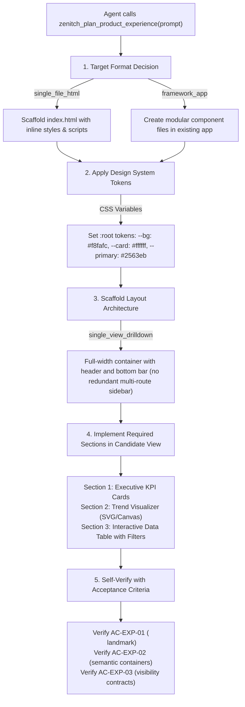

# Zenitch MCP — Product Experience Intelligence (PXI) Integration Design

**Document Version:** `1.0.0-design`  
**Phase:** Phase 2 Preparation (Design Only — Awaiting Architecture Approval)  
**Authors:** Senior MCP Architect & AI Coding-Agent Systems Engineer (Antigravity)  
**Architecture Reviewer:** ChatGPT  
**Date:** October 2026  
**Status:** `DESIGN PROPOSAL — AWAITING ARCHITECTURE REVIEW`

---

## 1. Executive Summary & Scope Boundaries

Following provisional approval of **PXI Phase 1** (`experience-planner.ts` deterministic library engine), this document specifies the architectural design for integrating the Experience Planner into the Zenitch MCP interface.

### Strict Design Gate Constraints
- **Design Only:** No source code modifications, MCP tool registrations, component contracts, policies, or dependencies are introduced in this gate.
- **Historical Benchmark Preservation:** Benchmark artifacts for Tasks 1–6 and historical hashes are strictly untouched.
- **Evidence Integrity:** Exposing the planner over MCP establishes interface availability only; it does **not** prove improved AI-generated UI quality. Genuine effectiveness claims require controlled end-to-end trials specified in Section 8.

---

## 2. Audit of Existing MCP Tool Registry

The Zenitch MCP server (`ZenitchServer` in `packages/zenitch-mcp/src/server.ts`) currently registers **10 baseline tools** (plus Zenitch memory/change tools when `ZENITCH_ENABLED=true`):

| Existing Tool Name | Primary Responsibility | Input Contract | Output Contract | Suitability for PXI |
|---|---|---|---|:---:|
| `zenitch_ping` | Health & connectivity check | `{}` | `{ status, timestamp }` | None |
| `zenitch_get_system_info` | Subsystem status & approval modes | `{}` | Subsystem inventory | None |
| `zenitch_analyze_product_context` | Product domain ergonomics baseline | `{ productName, domain, primaryUserGoal, targetAudience, dataDensity?, environment? }` | `{ domain, targetEnvironment, ergonomics, forbiddenPatterns, wcagTarget }` | **Highest Existing Candidate** |
| `zenitch_inspect_project` | Static codebase framework inspection | `{ projectRoot, scanDepth? }` | `{ framework, styling, packageManager, existingComponents, routes }` | Partial (Read-only context) |
| `zenitch_evaluate_design_policy` | Post-generation HTML/CSS rule audit | `{ html, css?, domain?, projectRoot? }` | `{ findings, score, compliancePercentage }` | None (Evaluation, not planning) |
| `zenitch_generate_design_system` | Design token generation | `{ domain, projectRoot?, constraints? }` | Palette, typography, spacing tokens | Low (Tokens only, no UX architecture) |
| `zenitch_resolve_component` | Component reuse vs. scaffold | `{ functionality, componentName?, projectRoot? }` | `{ action, componentPath, importStatement }` | Low (Single-component level) |
| `zenitch_audit_page_quality` | Accessibility, hit targets, overflow | `{ url?, html? }` | Quality audit scores & violations | None (Audit tool) |
| `zenitch_compare_visual_regression` | Pixel/layout shift comparison | `{ baselineImagePath, currentImagePath }` | Regression status & visual diff mask | None (Audit tool) |
| `zenitch_evaluate_animation_budget` | Hardware & reduced-motion budget | `{ animationTypes, dpr?, targetFps? }` | Motion budgets & CSS fallbacks | None (Localized animation) |

### Identification of Candidate Existing Tool:
Among existing tools, **`zenitch_analyze_product_context`** is the only tool operating at the product inception stage. An agent calls it before generating UI to understand domain ergonomics (e.g. healthcare light mode, luxury dark mode).

---

## 3. Extending Existing Tool vs. Dedicated MCP Tool

We evaluated two architectural integration patterns:

### Option A: Extend `zenitch_analyze_product_context`
In this approach, `zenitch_analyze_product_context` is overloaded to optionally accept `rawPrompt` and return an `experiencePlan` field:

```typescript
// Overloaded Input Schema
{
  productName?: string,
  domain?: ProductDomainEnum,
  primaryUserGoal?: string,
  rawPrompt?: string,                    // NEW optional field
  includeExperiencePlan?: boolean        // NEW flag
}
```

- **Advantages:**
  - Does not increase the tool registry count (keeps baseline at 10 tools).
  - Familiar single entrypoint for agents already calling product analysis.
- **Disadvantages & Architectural Flaws:**
  - **Schema Divergence:** `analyze_product_context` requires structured fields (`productName`, `domain`, `primaryUserGoal`), whereas an AI coding agent starting from a user prompt possesses only `rawPrompt`. Forcing the agent to invent structured inputs just to get an experience plan creates unnecessary friction.
  - **Single Responsibility Violation:** Conflates *Domain Ergonomics Classification* (static WCAG targets, color psychology) with *Full Application Experience Planning* (multi-view routing, layout archetypes, user flows, state models, acceptance criteria).
  - **Payload Bloat:** Agents that only need a quick WCAG contrast ratio or color recommendation would receive large multi-view experience plans, unnecessarily increasing context window token costs.

### Option B: Register Dedicated `zenitch_plan_product_experience` (Recommended)
Register a dedicated, single-purpose MCP tool specifically designed for application planning:

```typescript
// Dedicated Tool Input Schema
{
  rawPrompt: string,                     // Required: The user's application brief
  domainHint?: ProductDomainEnum,        // Optional: Manual domain override
  taskComplexity?: 'compact' | 'standard' | 'expanded' | 'auto_detect',
  targetFormat?: 'single_file_html' | 'multi_file_static' | 'framework_app' | 'auto_detect',
  designReference?: DesignReferenceSchema,
  projectRoot?: string,
  mode?: 'concise' | 'standard'          // Optional: Token-efficient summary
}
```

- **Advantages:**
  - **Zero Breaking Changes:** Leaves `zenitch_analyze_product_context` 100% backward-compatible and lightweight.
  - **Clean Ergonomics for AI Agents:** An agent with a raw user prompt ("Build a modern e-commerce product performance dashboard") can directly invoke this tool without first extracting entities.
  - **Internal Composition:** As established in Phase 1, `planProductExperience()` internally invokes `analyzeProductContext()` and `inspectProject()`, providing full synthesis without schema coupling.
  - **Targeted Invocation:** Agents call this tool only when starting a new application or major feature, avoiding overhead during bug fixes or minor edits.

### Comparative Decision Matrix:

| Evaluation Dimension | Option A: Extend `analyze_product_context` | Option B: Dedicated `plan_product_experience` (Recommended) |
|---|---|---|
| **Single Responsibility** | ❌ Poor (Overloads ergonomics with app planning) | ✅ Excellent (Dedicated planning lifecycle tool) |
| **Backward Compatibility** | ⚠️ Risky (Modifies existing tool contract) | ✅ 100% Safe (Existing tool contracts untouched) |
| **Token Efficiency for Ergonomics** | ❌ Poor (Inflates payload with view hierarchies) | ✅ Optimal (Zero overhead on ergonomics tool) |
| **Agent Prompt Ergonomics** | ❌ Awkward (Requires synthetic pre-parsing) | ✅ Natural (Accepts raw user prompt directly) |
| **Registry Footprint** | ✅ Zero change (10 tools) | ⚠️ +1 tool (11 baseline tools) |
| **Failure Isolation** | ❌ Intertwined (Planning failure breaks analysis) | ✅ Isolated (Engine failures cleanly bounded) |

**Recommendation:** Implement **Option B (`zenitch_plan_product_experience`)**. The minor addition of 1 tool to the registry is vastly outweighed by schema cleanliness, zero regression risk, and direct agent usability.

---

## 4. Proposed Input & Output Contracts

### 4.1 Input Schema (`PlanProductExperienceInputSchema`)
```typescript
import { z } from 'zod';
import { ProductDomainEnum } from './product.schema.js';

export const PlanProductExperienceInputSchema = z.object({
  rawPrompt: z.string().min(3, 'Prompt must describe the intended application'),
  domainHint: ProductDomainEnum.optional(),
  taskComplexity: z.enum(['compact', 'standard', 'expanded', 'auto_detect']).default('auto_detect'),
  targetFormat: z.enum(['single_file_html', 'multi_file_static', 'framework_app', 'auto_detect']).default('auto_detect'),
  designReference: z.object({
    referenceType: z.enum(['explicit_text_instruction', 'accessible_project_tokens', 'structured_reference_description', 'unspecified']).default('unspecified'),
    surfacePreference: z.enum(['light', 'dark', 'system', 'unspecified']).default('unspecified'),
    layoutPreference: z.enum(['sidebar', 'top_nav', 'tabbed', 'single_view', 'unspecified']).default('unspecified'),
    densityPreference: z.enum(['compact', 'comfortable', 'spacious', 'unspecified']).default('unspecified'),
    keyVisualCharacteristics: z.array(z.string()).default([])
  }).optional(),
  projectRoot: z.string().optional(),
  mode: z.enum(['concise', 'standard']).default('standard')
});

export type PlanProductExperienceInput = z.input<typeof PlanProductExperienceInputSchema>;
```

### 4.2 Output Schema (`ExperiencePlanOutputSchema`)
```typescript
export const ExperiencePlanOutputSchema = z.object({
  productName: z.string(),
  domain: ProductDomainEnum,
  derivedComplexity: z.enum(['compact', 'standard', 'expanded']),
  targetFormat: z.enum(['single_file_html', 'multi_file_static', 'framework_app']),
  formatRationale: z.string(),
  designDirection: z.object({
    selectedArchetype: z.string(),
    surfaceTone: z.enum(['light_neutral', 'dark_monochrome', 'warm_editorial', 'high_contrast', 'custom_user_override']),
    recommendedTheme: z.enum(['light', 'dark', 'system']),
    primaryColorRecommendation: z.string(),
    backgroundSurfaceHex: z.string(),
    cardSurfaceHex: z.string(),
    borderHierarchy: z.string(),
    rationale: z.string(),
    userOverrideApplied: z.boolean()
  }),
  layoutArchitecture: z.object({
    archetype: z.enum(['app_shell_sidebar', 'app_shell_topnav', 'single_view_drilldown']),
    sidebarCollapsible: z.boolean(),
    headerBreadcrumbs: z.boolean(),
    mobileNavigationPattern: z.enum(['bottom_bar', 'off_canvas_drawer', 'accordion_menu'])
  }),
  candidateViews: z.array(z.object({
    id: z.string(),
    title: z.string(),
    routeOrHash: z.string(),
    purpose: z.string(),
    isInitialView: z.boolean(),
    confidence: z.number().min(0).max(1),
    inclusionRationale: z.string(),
    requiredSections: z.array(z.string()),
    essentialComponents: z.array(z.string()),
    dataEntities: z.array(z.string())
  })),
  userFlows: z.array(z.object({
    flowId: z.string(),
    description: z.string(),
    stepSequence: z.array(z.string())
  })),
  sharedStateModel: z.array(z.object({
    stateKey: z.string(),
    type: z.string(),
    defaultValue: z.string(),
    consumers: z.array(z.string())
  })),
  inferredAssumptions: z.array(z.string()),
  unsupportedCapabilities: z.array(z.string()),
  acceptanceCriteria: z.array(z.object({
    id: z.string(),
    title: z.string(),
    definition: z.string(),
    verificationType: z.enum(['static_html', 'policy_engine', 'runtime_manual'])
  }))
});
```

---

## 5. Representative Output & Agent Consumption

### 5.1 Representative Output: Prompt A ("Build a modern e-commerce product performance dashboard")

```json
{
  "productName": "Product Performance Dashboard",
  "domain": "ecommerce",
  "derivedComplexity": "compact",
  "targetFormat": "single_file_html",
  "formatRationale": "Defaulting to portable single-file architecture with in-page view switching for low deployment overhead.",
  "designDirection": {
    "selectedArchetype": "Clean Slate Administrative",
    "surfaceTone": "light_neutral",
    "recommendedTheme": "light",
    "primaryColorRecommendation": "#2563eb",
    "backgroundSurfaceHex": "#f8fafc",
    "cardSurfaceHex": "#ffffff",
    "borderHierarchy": "1px solid #e2e8f0",
    "rationale": "Standard daylight administrative baseline for ecommerce prioritizing high scannability and accurate data representation.",
    "userOverrideApplied": false
  },
  "layoutArchitecture": {
    "archetype": "single_view_drilldown",
    "sidebarCollapsible": false,
    "headerBreadcrumbs": false,
    "mobileNavigationPattern": "bottom_bar"
  },
  "candidateViews": [
    {
      "id": "dashboard",
      "title": "Product Performance Dashboard Overview",
      "routeOrHash": "#/dashboard",
      "purpose": "Unified primary view for operational metrics, performance trends, and summary data",
      "isInitialView": true,
      "confidence": 1.0,
      "inclusionRationale": "Primary operational view fulfilling core user intent.",
      "requiredSections": [
        "Executive KPI Metric Cards",
        "Performance Trend Visualizer",
        "Interactive Summary Data Table",
        "Date & Category Filter Controls"
      ],
      "essentialComponents": [
        "kpi_card",
        "trend_chart",
        "data_table",
        "filter_bar"
      ],
      "dataEntities": [
        "AggregatedMetrics",
        "PrimaryEntityRecord"
      ]
    }
  ],
  "userFlows": [
    {
      "flowId": "FLOW-01-PRIMARY-NAVIGATION",
      "description": "User inspects primary KPI metrics, adjusts filters, and navigates data table rows",
      "stepSequence": [
        "Navigate to Product Performance Dashboard Overview (#/dashboard)"
      ]
    }
  ],
  "sharedStateModel": [
    {
      "stateKey": "activeView",
      "type": "string",
      "defaultValue": "dashboard",
      "consumers": ["NavigationSidebar", "ViewContainerManager"]
    },
    {
      "stateKey": "searchQuery",
      "type": "string",
      "defaultValue": "",
      "consumers": ["DataToolbar", "CatalogTable"]
    }
  ],
  "inferredAssumptions": [
    "Assessed compact application complexity based on prompt workflow scope.",
    "Derived light theme from ecommerce domain ergonomic baseline.",
    "Client-side region switching used to preserve single-file portability."
  ],
  "unsupportedCapabilities": [
    "Raw visual screenshot pixel parsing is not supported (Zenitch runs headlessly without multimodal vision models; references must be provided as structured descriptions or tokens).",
    "Runtime browser DOM event loop execution and layout geometry rendering are not performed statically."
  ],
  "acceptanceCriteria": [
    {
      "id": "AC-EXP-01",
      "title": "Navigation Landmark & Active View Indication",
      "definition": "Application declares a semantic <nav> landmark with aria-label and exposes active view with aria-current=\"page\".",
      "verificationType": "static_html"
    },
    {
      "id": "AC-EXP-02",
      "title": "Candidate View Container Integrity",
      "definition": "All 1 candidate views have corresponding semantic containers with unique IDs and accessible labels.",
      "verificationType": "static_html"
    },
    {
      "id": "AC-EXP-03",
      "title": "View Switching Visibility Contract",
      "definition": "Initial view is visible; inactive views are visually hidden using standalone hidden attributes or display:none.",
      "verificationType": "static_html"
    }
  ]
}
```

### 5.2 How an AI Coding Agent Consumes This Plan

When the AI coding agent receives this JSON response from `zenitch_plan_product_experience`, it executes a 5-step structured code generation sequence:



1. **Format Decision (`targetFormat`):**
   - The agent sees `single_file_html`. It avoids `import` statements or external bundlers and bundles CSS/JS directly in `index.html`.
2. **Surface & Palette Injection (`designDirection`):**
   - The agent defines CSS custom properties using the recommended values (`--bg: #f8fafc`, `--surface: #ffffff`, `--border: #e2e8f0`, `--primary: #2563eb`), avoiding neon colors or inappropriate dark-mode defaults.
3. **Layout Assembly (`layoutArchitecture`):**
   - The agent sees `single_view_drilldown` with 1 view. It recognizes that a complex sidebar with dummy multi-page links is **unjustified**, producing a clean header + single drilldown view instead.
4. **Component & Section Hierarchy (`candidateViews[0].requiredSections`):**
   - Rather than wondering what to put on the dashboard, the agent implements the exact structured hierarchy: KPI grid $\to$ Trend chart $\to$ Filter bar $\to$ Data table.
5. **Pre-Flight Verification (`acceptanceCriteria`):**
   - The agent checks its own generated markup against `AC-EXP-01`, `AC-EXP-02`, and `AC-EXP-03` before running `zenitch_evaluate_design_policy`.

---

## 6. Architectural Differentiation Capabilities

The integration design guarantees four distinct architectural behaviors:

### 6.1 Single-Page Dashboard vs. Multi-Screen Portal
- **Single-Page Dashboard** (Prompt A: "Build a modern e-commerce product performance dashboard"):
  - Complexity: `compact`.
  - Candidate Views: Exactly 1 (`dashboard`).
  - Layout: `single_view_drilldown`.
  - Rationale: A performance dashboard is a unified monitoring screen, not a multi-page portal.
- **Multi-Screen Portal** (Prompt B: "Build an e-commerce management portal with products, orders, customers, and analytics"):
  - Complexity: `expanded`.
  - Candidate Views: 4 views (`dashboard`, `products`, `orders`, `customers`).
  - Layout: `app_shell_sidebar`.
  - Rationale: Multiple distinct operational entities require dedicated views.

### 6.2 Explicit User Design Intent vs. Domain Defaults
- **Prompt:** "Use a dark editorial design with compact charts."
- **Behavior:** The planner ignores the default light administrative palette of editorial/ecommerce and honors explicit intent:
  - `recommendedTheme: 'dark'`
  - `surfaceTone: 'warm_editorial'`
  - `selectedArchetype: 'Dark Editorial Monograph'`
  - Palette: `#1c1917` warm stone background, `#292524` warm card, `#44403c` stone border, `#f59e0b` amber accent.
  - `userOverrideApplied: true`.

### 6.3 Existing Project Framework vs. Single-File Constraints
- **Prompt:** "Improve the dashboard in my existing Next.js project."
- **Behavior:**
  - `targetFormat: 'framework_app'`
  - `formatRationale: 'Respecting detected repository framework convention (Next.js)...'`
  - Prevents the agent from hallucinating a standalone `index.html` file that ignores the existing repository.

### 6.4 Ambiguous Inputs Without Invented Requirements
- **Prompt:** "make an app" or "a tool to view numbers"
- **Behavior:**
  - Classifies as `compact`.
  - Emits 1 view (`dashboard`) with generic, safe defaults.
  - Transparently documents assumptions in `inferredAssumptions` rather than hallucinating elaborate enterprise workflows.

---

## 7. Invocation Boundaries & Token Optimization

### When an Agent SHOULD Invoke `zenitch_plan_product_experience`
1. **Application Scaffolding:** Initial creation of a web application, dashboard, or portal.
2. **Major Feature Inception:** Adding a major subsystem requiring multi-view workflow coordination.
3. **Architecture Planning:** When translating high-level, ambiguous user briefs into actionable component hierarchies.

### When an Agent SHOULD NOT Invoke `zenitch_plan_product_experience`
1. **Bug Fixes:** Fixing an alignment bug, broken form submission, or CSS issue.
2. **Localized Refactoring:** Cleaning up an existing function or component.
3. **Adding a Single Component:** Adding a dropdown or button (use `zenitch_resolve_component` instead).
4. **Policy Auditing:** Verifying compliance of completed code (use `zenitch_evaluate_design_policy`).

### Token Cost Controls:
- **Concise Mode (`mode: 'concise'`):** Omit `alternativeDirections` and detailed `userFlows`, reducing payload from $\approx 1.8\text{k tokens}$ to $\approx 650\text{ tokens}$.
- **Bounded Constraints:**
  - Candidate views are capped at $\le 4$.
  - View rationale strings are strictly bounded to $\le 120\text{ characters}$.
  - State model items are capped at $\le 5$.

---

## 8. System Implications

| Dimension | Architectural Implication & Mitigation |
|---|---|
| **Backward Compatibility** | **Zero Impact:** Existing 10 baseline tools in `ZenitchServer` retain identical schemas and handler signatures. |
| **Execution Latency** | **Bounded $<1\text{ ms}$:** Pure in-memory deterministic heuristic planning. Zero async I/O unless `projectRoot` is provided (where disk inspection is bounded to depth 3 and skips `node_modules`). |
| **Error Handling** | **Structured Validation Errors:** Input validation via `ZodError` returns standard MCP `isError: true` with structured issue codes. Unhandled path errors safely fall back to portable defaults. |
| **Security Controls** | **Strict Read-Only & Secret Redaction:** `projectRoot` inspection uses `path.resolve`, blocks directory traversal, and redacts `.env` files automatically. |
| **Token Cost** | **Bounded:** Typical standard response is $\approx 1.2\text{k tokens}$; concise mode is $\approx 650\text{ tokens}$. Negligible overhead for application scaffolding. |

---

## 9. Proposed MCP Integration Test Specification

To be implemented upon Phase 2 authorization in `tests/server.test.ts`:

```typescript
test('ZenitchServer: executes zenitch_plan_product_experience via CallTool and returns valid plan', async () => {
  const server = new ZenitchServer({ logLevel: 'ERROR' });
  const internalServer = server.getServerInstance();

  const callHandler = (internalServer as any)._requestHandlers.get(CallToolRequestSchema.shape.method.value);
  const response = await callHandler({
    method: 'tools/call',
    params: {
      name: 'zenitch_plan_product_experience',
      arguments: {
        rawPrompt: 'Build a modern e-commerce product performance dashboard.',
        targetFormat: 'single_file_html'
      }
    }
  });

  assert.equal(response.isError, false);
  const parsedContent = JSON.parse(response.content[0].text);
  assert.equal(parsedContent.success, true);
  
  const plan = parsedContent.data;
  assert.equal(plan.productName, 'Product Performance Dashboard');
  assert.equal(plan.domain, 'ecommerce');
  assert.equal(plan.derivedComplexity, 'compact');
  assert.equal(plan.candidateViews.length, 1);
  assert.equal(plan.candidateViews[0].id, 'dashboard');
  assert.equal(plan.layoutArchitecture.archetype, 'single_view_drilldown');
  assert.doesNotThrow(() => ExperiencePlanOutputSchema.parse(plan));
});
```

---

## 10. Controlled Evaluation Protocol (Phase 3 Preparation)

> [!IMPORTANT]
> **Integrity Assertion:** Exposing `zenitch_plan_product_experience` over MCP proves interface integration only. It does **not** prove that AI coding agents produce higher quality web applications.

To substantiate product experience improvement claims, a future controlled evaluation (Phase 3) must adhere to this strict experimental design:

1. **Identical Frontier Model:** An un-fine-tuned, unmodified frontier model (e.g. Claude 3.5 Sonnet) executes all conditions.
2. **Conditions:**
   - **Baseline Condition ($C_0$):** Model receives the raw prompt with access to standard filesystem/command tools only.
   - **PXI-Assisted Condition ($C_1$):** Model receives the identical prompt with Zenitch MCP and `zenitch_plan_product_experience` registered.
3. **Objective Evaluation Protocol:**
   - Evaluated by automated, deterministic evaluators (e.g., verifying landmark `<nav>` presence, view container visibility contracts, interactive filter functions, dead-interaction indicators, and policy compliance).
   - **Zero Hand-Authored Fixtures:** All generated HTML files must be captured directly from autonomous agent execution runs with complete command transcripts and token logs.

---

## 11. Acceptance Criteria & Unresolved Architecture Risks

### Acceptance Criteria for Phase 2 Implementation:
1. `zenitch_plan_product_experience` registered in `ZenitchServer.setupTools()` with description and Zod schema.
2. Handler routes directly to `planProductExperience()`.
3. All existing 10 baseline tools remain untouched.
4. Server test suite verifies CallTool execution over stdio/internal transport.
5. Zero modifications to historical Tasks 1–6 benchmark artifacts.

### Unresolved Architecture Risks & Mitigations:
1. **Risk:** Over-reliance by AI agents for trivial edits.
   - *Mitigation:* Explicit tool description states: *"Use ONLY during initial application scaffolding or major feature planning. Do NOT use for bug fixes, single components, or minor refactoring."*
2. **Risk:** Ambiguous prompts producing unexpected domains.
   - *Mitigation:* Exposes `domainHint` parameter allowing the agent to provide explicit domain override if inferred incorrectly.
3. **Risk:** Performance degradation on large monorepos during `projectRoot` inspection.
   - *Mitigation:* `inspectProject()` is bounded to scan depth 3 and strictly skips `node_modules`, `.git`, `.next`, and build directories.

---

## 12. Recommendation Summary

| Option | Recommendation | Next Step |
|---|---|---|
| **Option B (`zenitch_plan_product_experience`)** | **RECOMMENDED** | Await Architecture Review sign-off before implementing in Phase 2. |
